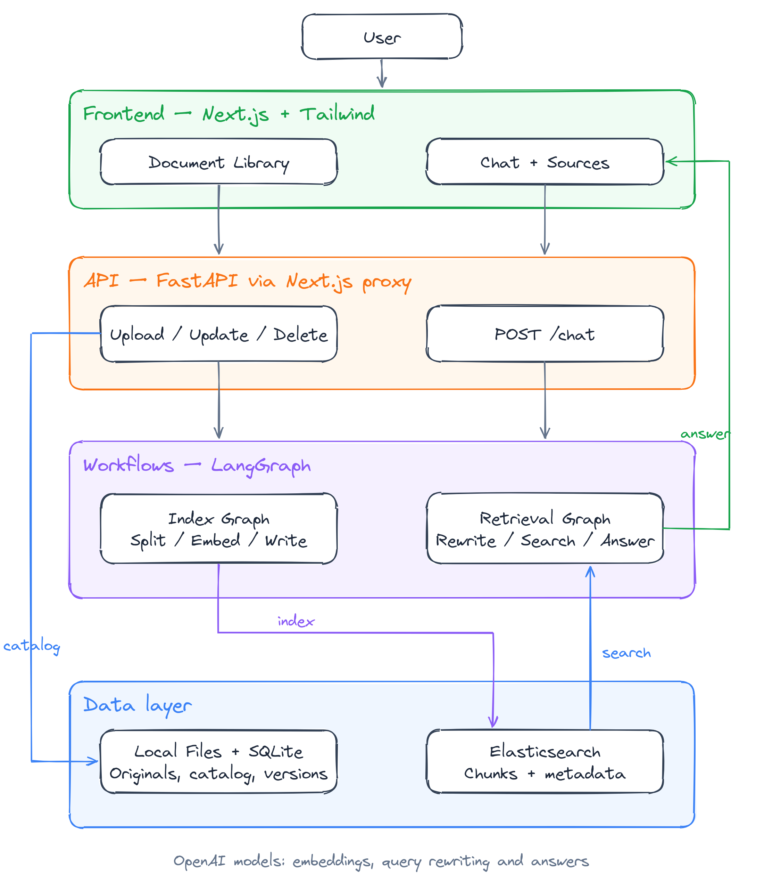
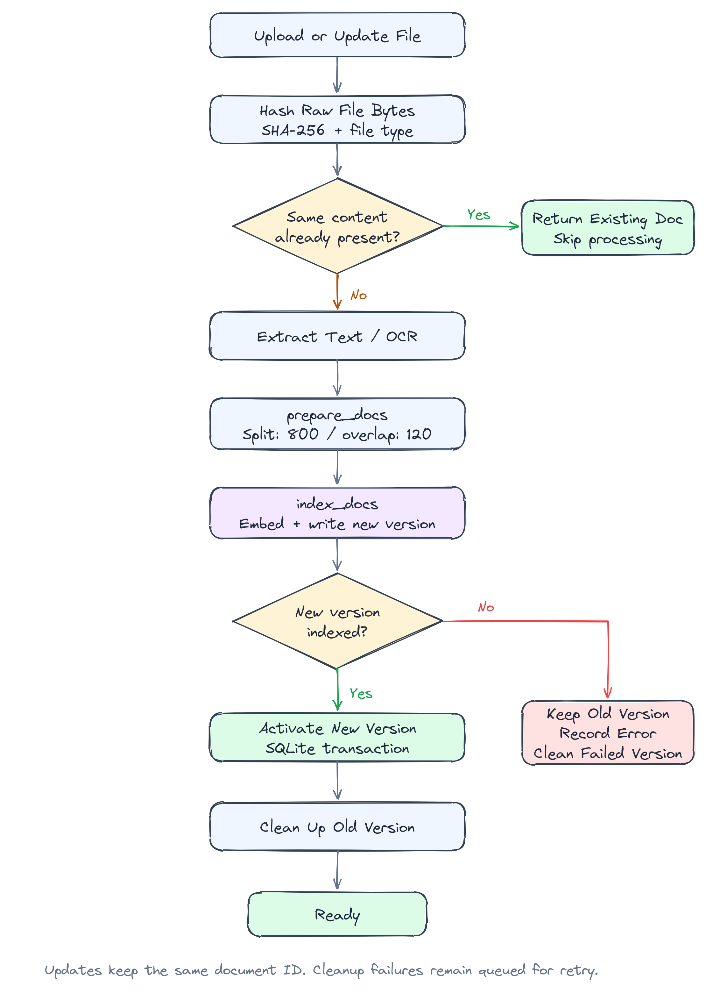
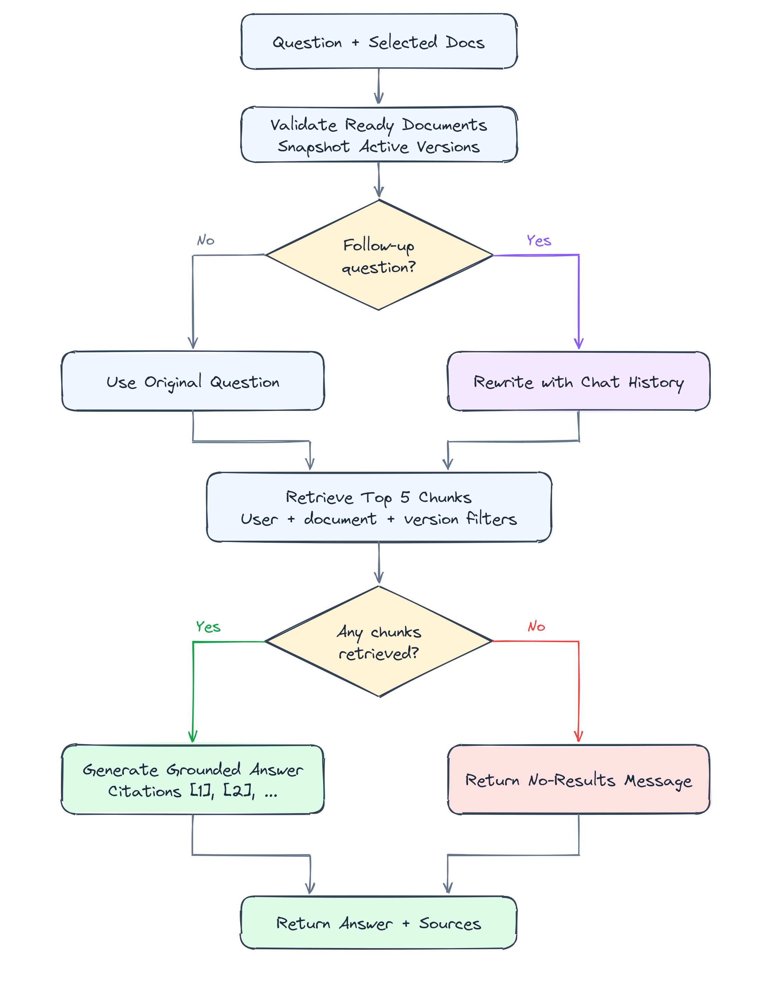

# RAG Agent

A document question-answering system built with LangChain and LangGraph, backed by Elasticsearch and served through a Next.js interface. Upload documents, extract text with OCR when needed, and ask questions against selected sources. The ingestion pipeline supports document-level incremental updates; answers include retrieved passages and page references when available.

## Table of Contents

- [Architecture Overview](#architecture-overview)
- [Document Ingestion](#document-ingestion)
- [Incremental Updates](#incremental-updates)
- [Retrieval Graph](#retrieval-graph)
- [Technology Stack](#technology-stack)
- [Project Structure](#project-structure)
- [Backend API Reference](#backend-api-reference)
- [Frontend](#frontend)
- [Configuration](#configuration)
- [Getting Started](#getting-started)
- [Verification](#verification)
- [Current Scope](#current-scope)

## Architecture Overview

The Next.js frontend sends document and chat requests through a server-side proxy to FastAPI. The backend manages uploads and document versions in local files and SQLite, then invokes separate LangGraph workflows for indexing and retrieval. Elasticsearch stores document chunks, embeddings and retrieval metadata; OpenAI models provide embeddings, query rewriting and answers.

<p align="center">
  
</p>

The application runs as a local, single-user service. The configured user ID scopes retrieval, while selected document IDs and active versions determine which chunks can contribute to an answer.

## Document Ingestion

Uploads are handled in `backend/main.py`, extraction in `backend/loaders.py`, and chunking and indexing in `graphs/index_graph.py`. Accepted files are saved locally before an in-process background task parses and indexes them. Parsing and indexing run serially.

<p align="center">
  
</p>

| Step | Responsibility |
| :--- | :--- |
| File validation | Check the filename, supported extension, non-empty content and upload size |
| Content fingerprint | Compute SHA-256 over the original file bytes and compare it with stored hashes of the same file type |
| `load_documents` | Extract document text and attach source, document ID and page metadata where available |
| `prepare_docs` | Attach the configured user ID and split text into chunks of up to 800 characters with 120-character overlap |
| `index_docs` | Generate embeddings and write chunks with version metadata and deterministic IDs; refresh the index before activation |
| Version activation | Commit the active version in SQLite, then clean up obsolete vectors and original files |

**Supported formats:**

| Format | Extraction |
| :--- | :--- |
| TXT, Markdown | Decode UTF-8, with a GB18030 fallback |
| DOCX | Extract paragraphs and table text from the document XML |
| PDF | Extract embedded text page by page; use PaddleOCR on pages without extracted text |
| PNG, JPG, JPEG, WebP | Extract text with PaddleOCR |

The default limits are 20 MB per file, 200 pages per PDF and 2 million extracted characters. PDF page numbers are retained for citations. DOCX layout and embedded images are not preserved; PDF pages containing both text and images do not receive additional OCR for their image regions.

## Incremental Updates

Updates operate at the **document level**. Matching raw file bytes and file type skip parsing and embedding. Renaming a file without changing its bytes or type still counts as a duplicate. Files with the same extracted text but different binary contents are not necessarily duplicates.

| Scenario | Behavior |
| :--- | :--- |
| Upload content already indexed | Return the existing document with `unchanged: true` |
| Upload content already being processed | Return the document associated with the pending version |
| Update an existing document with unchanged content | Keep the current version and skip indexing |
| Update with changed content | Keep the document ID, build a new version, then activate it |
| New-version processing fails | Retain the previous ready version and expose an error for retry |
| Old-version cleanup fails | Retain cleanup records and retry after a later update or server restart |
| Server restarts during processing | Discard the interrupted pending version; preserve the previous ready version, if any |

While an existing document is updating, it remains `ready` with `updating: true`, so questions can still use its previous version. The backend switches versions only after indexing succeeds. Retrieval filters exclude obsolete and partially written versions.

SQLite schema changes are additive. Existing ready documents use a `legacy` version that matches Elasticsearch chunks without version metadata; their file hashes are populated when needed. Existing documents do not require immediate re-indexing.

Changed documents are fully re-embedded. Chunk-level vector reuse and automatic rebuilds after model or splitter configuration changes are not implemented. A matching filename alone never overwrites a document: use the update endpoint or select an update target in the UI.

## Retrieval Graph

The question-answering workflow is defined in `graphs/graph.py`. The API first verifies that selected documents are ready and captures their active versions. The graph prepares a search query, retrieves matching chunks and generates an answer from those passages.

<p align="center">
  
</p>

| Step | Responsibility |
| :--- | :--- |
| `prepare_query` | Use the original question for the first message; generate a structured search query from conversation history for follow-ups |
| `retrieve` | Search Elasticsearch for up to five chunks, filtered by user ID, selected document IDs and their active versions |
| `answer` | Generate an answer using the retrieved passages and numbered citations; return a no-results message if retrieval returns no chunks |
| API response mapping | Return the answer and retrieved source passages, including PDF page numbers when present |

The answer prompt instructs the model to use only the supplied documents, say when the answer is unavailable, and treat document contents as untrusted data. The service checks that returned evidence belongs to the selected documents and versions. Conversations are supplied by the browser on each request; the backend does not persist chat threads.

## Technology Stack

| Layer | Technology | Purpose |
| :--- | :--- | :--- |
| Workflow engine | LangGraph | Explicit ingestion and retrieval graphs |
| RAG framework | LangChain | Documents, splitters, retrievers and model integration |
| Language models | OpenAI | Query rewriting and grounded answer generation |
| Embeddings | OpenAI Embeddings | Vector representations of document chunks and queries |
| Search storage | Elasticsearch, `langchain-elasticsearch` | Vector retrieval and metadata filtering |
| API runtime | FastAPI, Uvicorn, Pydantic | Upload, update, delete and chat endpoints |
| Frontend | Next.js, React, TypeScript, Tailwind CSS | Document management, chat and source inspection |
| Document catalog | SQLite | Document metadata, hashes, processing state and versions |
| Original files | Local filesystem | Uploaded documents and version-specific originals |
| OCR and PDF | PaddleOCR, PaddlePaddle, pypdfium2 | Image recognition and PDF text extraction |
| Configuration | python-dotenv, dataclasses | Environment loading and graph configuration |

## Project Structure

```text
rag-agent/
|-- backend/
|   |-- main.py                  # FastAPI endpoints and background processing
|   |-- service.py               # Graph adapters, version filters and ES deletion
|   |-- storage.py               # SQLite catalog, migrations and version state
|   |-- loaders.py               # Text, DOCX, PDF and image extraction
|   |-- settings.py              # Backend environment configuration
|   |-- requirements.txt         # Python dependencies
|   |-- tests/                   # API, incremental update and graph adapter tests
|   |-- data/                    # Runtime catalog and uploads
|-- graphs/
|   |-- index_graph.py           # Chunking and vector indexing graph
|   |-- graph.py                 # Query preparation, retrieval and answer graph
|   |-- retrieval.py             # Embedding model and Elasticsearch retriever
|   |-- ocr.py                   # Lazy, serialized PaddleOCR integration
|   |-- configuration.py         # Runnable graph configuration
|   |-- state.py                 # Graph state and document reducers
|   |-- schema.py                # Structured search query output
|   |-- prompts.py               # Query generation and answer prompts
|   |-- utils.py                 # Message and date helpers
|-- frontend/
|   |-- src/app/page.tsx         # Document management and chat interface
|   |-- src/app/api/backend/
|   |   |-- [...path]/route.ts   # Server-side proxy to FastAPI
|   |-- src/lib/                 # UI types
|   |-- package.json            # Frontend dependencies and scripts
|-- docs/
|   |-- images/                 # README workflow images
|   |-- diagrams/               # Editable Excalidraw source files
|-- .env                        # Local configuration; do not commit credentials
|-- README.md
```

## Backend API Reference

The FastAPI backend defaults to `http://127.0.0.1:8000` in the local setup below. The browser uses `/api/backend/*` on the Next.js server, which forwards allowed requests to the configured backend.

| Method | Endpoint | Description | Response |
| :--- | :--- | :--- | :--- |
| GET | `/health` | Check that the API is running | Status, local mode and `dependencies_checked: false` |
| GET | `/documents` | List catalog entries | `documents` array |
| POST | `/documents` | Upload multipart field `file` | `document`, `unchanged`; 202 for processing or 200 for an indexed duplicate |
| PUT | `/documents/{id}/content` | Replace the content of an existing document | `document`, `unchanged`; 202 for processing or 200 for unchanged content |
| DELETE | `/documents/{id}` | Delete the document, its versions and original files | 204 on success |
| POST | `/chat` | Ask a question against selected ready documents | `answer`, `citations` |

Example chat payload:

```json
{
  "conversation_id": "b3a59114-43b7-4a2a-b742-79d36daa83fd",
  "document_ids": ["d2c98772-74da-4c20-a7b5-325b8f066aac"],
  "messages": [
    {"role": "user", "content": "What are the main findings in this document?"}
  ]
}
```

Replace `document_ids` with IDs returned by the document API. `conversation_id` is validated as a UUID but is not a persisted server-side thread.

### Frontend Response Mapping

| Field | Description |
| :--- | :--- |
| `document.id`, `name`, `kind`, `size` | Stable document ID, filename, file type and size in bytes |
| `status` | `processing`, `ready` or `error` |
| `updating` | Whether a replacement or initial version is being processed |
| `addedAt`, `updatedAt` | Initial upload time and latest successful activation time |
| `excerpt`, `error` | Extracted text preview and processing error message |
| `answer` | Assistant response for the current turn |
| `citations` | Retrieved passages with `documentId`, `name`, `excerpt` and optional `page` |

Chat requests accept 1–50 selected document IDs and 1–80 messages, with a maximum of 8,000 characters per message and 100,000 characters in the conversation. The last message must be from the user. The UI waits for the complete response rather than streaming tokens.

## Frontend

The Next.js interface in `frontend/` provides:

- **Document uploads** with file type and size guidance.
- **Content updates** through an explicit update target while preserving document selection by ID.
- **Processing status** refreshed every three seconds while documents are being processed.
- **Source selection** to limit questions to chosen ready documents.
- **Conversational chat** with follow-up questions and a clear-chat action.
- **Source inspection** through expandable retrieved passages and available page references.
- **Document deletion** with confirmation and backend cleanup.

Click **Update** beside a document, select the replacement file and click **Update file**. Identical content is skipped. Chat history exists only in the current page and is cleared on refresh; uploaded documents persist in the backend.

## Configuration

Backend settings load `backend/.env` first, then the root `.env`, without overriding existing process environment variables. Graph configuration receives these settings through `RagService`. Restart the backend after changing its configuration.

| Setting | Default | Description |
| :--- | :--- | :--- |
| `OPENAI_API_KEY` | Required | Credential for the configured OpenAI models |
| `RAG_ELASTICSEARCH_URL` | Falls back to `ELASTICSEARCH_URL` | Elasticsearch address used for indexing, retrieval and deletion |
| `ELASTICSEARCH_URL` | Required when no override is set | Base Elasticsearch address |
| `ELASTICSEARCH_USER` | Required for `elastic-local` | Elasticsearch username |
| `ELASTICSEARCH_PASSWORD` | Required for `elastic-local` | Elasticsearch password |
| `ELASTICSEARCH_API_KEY` | Required for `elastic-cloud` | API key used with the configured Elasticsearch URL |
| `RAG_RETRIEVER_PROVIDER` | `elastic-local` | Choose `elastic-local` or `elastic-cloud` |
| `RAG_INDEX_NAME` | `folio_documents_v1` | Index used by the web application |
| `RAG_USER_ID` | `local-user` | Fixed server-side retrieval scope; not an authenticated identity |
| `RAG_DATA_DIR` | `backend/data` | SQLite catalog and uploaded original files |
| `RAG_EMBEDDING_MODEL` | `text-embedding-3-small` | Embedding model used for documents and queries |
| `RAG_CHAT_MODEL` | `gpt-4.1-mini` | Answer model; choose one available to your account |
| `RAG_QUERY_MODEL` | Value of `RAG_CHAT_MODEL` | Follow-up query model with structured-output support |
| `RAG_OCR_LANGUAGE` | `en` | PaddleOCR recognition language; use `ch` for Chinese/mixed documents |
| `RAG_API_URL` | Required by the frontend proxy | FastAPI address, set in `frontend/.env.local` |

Direct graph calls use the defaults in `graphs/configuration.py`, including the index `langchain_index`. The web API supplies its own settings through `RagService`; indexing through a direct graph call does not create a web catalog entry.

## Getting Started

### Prerequisites

- Python 3.12, matching the environment used to verify this project.
- Node.js and npm compatible with the Next.js version in `frontend/package.json`.
- A running Elasticsearch service with vector-search support and valid credentials.
- An OpenAI API key with access to the configured chat and embedding models.

PaddleOCR runs on CPU in the current implementation. Its first use may download recognition models. Elasticsearch must be started separately; the repository does not include a Docker Compose deployment.

### Installation

The examples below use Windows PowerShell. Run them from the project root:

```powershell
python -m venv .venv
.\.venv\Scripts\python.exe -m pip install --upgrade pip
.\.venv\Scripts\python.exe -m pip install -r backend/requirements.txt

cd frontend
npm install
cd ..
```

### Environment Variables

Create `.env` in the repository root and replace the placeholders:

```dotenv
OPENAI_API_KEY=your_openai_api_key

ELASTICSEARCH_URL=http://127.0.0.1:9200
ELASTICSEARCH_USER=your_elasticsearch_user
ELASTICSEARCH_PASSWORD=your_elasticsearch_password
RAG_RETRIEVER_PROVIDER=elastic-local
RAG_INDEX_NAME=folio_documents_v1
RAG_USER_ID=local-user

RAG_EMBEDDING_MODEL=text-embedding-3-small
RAG_CHAT_MODEL=gpt-4.1-mini
RAG_QUERY_MODEL=gpt-4.1-mini
RAG_OCR_LANGUAGE=en
```

Use the URL and protocol exposed by your Elasticsearch service. HTTPS deployments require valid certificate trust. Keep credentials out of version control.

Create `frontend/.env.local`:

```dotenv
RAG_API_URL=http://127.0.0.1:8000
```

### Running the Application Locally

Open two terminals in the repository root.

**Terminal 1 — backend:**

```powershell
$env:PYTHONUTF8 = "1"
.\.venv\Scripts\python.exe -m uvicorn backend.main:app --host 127.0.0.1 --port 8000 --workers 1
```

**Terminal 2 — frontend:**

```powershell
cd frontend
npm run dev
```

Open [the document chat interface](http://127.0.0.1:3000). Upload a document, wait until it is ready, select it and ask a question. The [interactive API documentation](http://127.0.0.1:8000/docs) exposes the backend request schemas.

The [health endpoint](http://127.0.0.1:8000/health) checks only that the API is running; it does not verify Elasticsearch or model-provider connectivity. If the UI cannot reach the backend, check both processes and `RAG_API_URL`. Restart the frontend after changing `.env.local`.

## Verification

Run the backend tests from the project root:

```powershell
.\.venv\Scripts\python.exe -m unittest discover -s backend/tests -v
```

Check the frontend:

```powershell
cd frontend
npm run typecheck
npm run build
```

Tests cover document APIs, file validation, duplicate detection, version activation, failure recovery, legacy catalog migration, retrieval filters and graph adapters. External search and model services are replaced with test doubles; passing tests does not establish that a live Elasticsearch instance or model account is configured correctly.

Workflow images are stored in `docs/images/`. Their editable sources are in `docs/diagrams/` and can be opened in [Excalidraw](https://excalidraw.com).

## Current Scope

This is a local, single-user application. It does not implement login, RBAC, multi-tenant authorization, a durable job queue, cloud deployment or automatic scaling. Backend coordination uses in-process locks, so run one worker. Interrupted jobs require a manual update retry after recovery.

Document contents are sent to the configured embedding and chat services when those operations run. Uploaded originals and catalog records are stored on the backend filesystem. Chat persistence, live token streaming and chunk-level embedding reuse are outside the current implementation.
